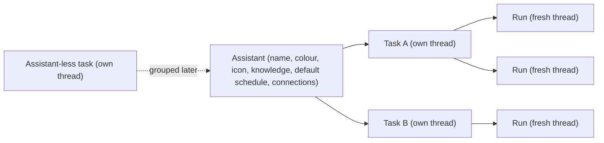

# Assistant View

Assistant View is a top-level view alongside Projects and Chats. It holds
**assistants** and **tasks**, schedules agent runs, and hands task threads off to
projects. This document is the contract for the assistant model, the scheduler,
the missed-run surfaces, the knowledge authoring flow, and fork hand-off.

## Model

- **Assistant** is the group ("Triage CodeInOven PRs daily, 9am and 5pm"). It owns
  the agent-authored knowledge, a default schedule, and connection picks. Type:
  `src/lib/types/assistant.ts`; persisted in the `assistants` table via
  `src/main/database/repositories/assistant-repo.ts` and managed by
  `src/lib/engines/assistant-manager.ts`.
- **Task** is a thread in the hidden assistant space container
  (`ASSISTANT_SPACE_ID`, `src/lib/types/project.ts`) with an optional
  `assistantId`. It is the user's own conversation about the task; a task may
  exist without an assistant. Assistant threads are excluded from Projects and
  Chats because the container is a hidden project, exactly like the inbox.
- **Run** is one execution of a task, on its **own fresh thread**. Every
  scheduled fire, missed-run **Run now**, and assistant **Run now** creates one,
  so a run never lands in the task's conversation and a run's transcript carries
  only that execution. A run thread is a thread like any other (it can be
  renamed, pinned, forked, noted, handed off, and deleted), it inherits its
  task's `assistantId` so the engine keeps composing the assistant's knowledge and run
  contract into its system prompt, and it links back through
  `Thread.assistantTaskId` (`isAssistantRunThread`). **Only an assistant's Getting
  started thread hosts the getting-started run** the authoring conversation
  and no task's scheduled run ever executes on a task's own thread.
- **Forking stays in the assistant.** A fork copies history into a new thread in
  the same assistant space and carries the parent's `assistantId` (plus its
  icon and schedule override), so the copy sits under that assistant. It is
  never a run and never the knowledge thread, so neither link travels.
- **Hierarchy is always Assistant -> Task -> runs.** A run is never a task: it is
  never scheduled and never grouped. An assistant row's count states its threads,
  so the tasks and their runs are both counted there. Each task may override its
  assistant's schedule (`scheduleOverride`), and shows a custom icon
  (`assistantIconType`) on its row.

### V1 pillars

1. Core view + knowledge panel (`src/renderer/lib/components/assistant/`).
2. Main-process scheduler with missed-run detection
   (`src/main/scheduler/assistant-scheduler-service.ts`).
3. Agent-authored knowledge flow (in-thread authoring, a recap the user confirms).
4. Fork hand-off to a project, from the task's own context menu
   (`assistant-handoff.svelte.ts`, `AssistantHandoffModals.svelte`).

### Explicitly deferred

Thread-per-run is implemented, not deferred: every run executes on a fresh
thread (see **Model**). Still deferred: automatic catch-up of missed schedules,
a standalone Task entity, a new `threadKind` flag, hand-off by move (not fork),
and a permanent general assistant chat. The header's **New task** action creates
an assistant-less task instead, and creates it with no extra naming step.

### Workspace

An assistant behaves like a project, so its tasks run inside the assistant's own
workspace instead of a shared scratch directory:

- The assistant container itself is hidden with no path, like the inbox. When a
  session needs a directory, `resolveProjectPath`
  (`src/main/chat/chat-engine.ts`) maps it to the app-storage root
  `assistant-cwd/`.
- `resolveThreadPath` then scopes every assistant thread to
  `assistant-cwd/<assistantId>/`, so work in one assistant can never touch another's
  files. An assistant-less task gets `assistant-cwd/<threadId>/`.
- A **run thread inherits its task's `assistantId`**, so every run of an assistant
  works in that same assistant directory and its artifacts land with the assistant's
  other work; the file tree mounted in the rail therefore reads the same root
  whether the user opens the task or one of its runs.
- That assistant directory is the session's working directory and its permission
  project root, so artifacts, generated images, and any files the agent writes
  land under the assistant. Assistant threads get no chat workspace scratch
  path, and `assistant-cwd` is registered as an app artifact root so the
  renderer can show those files.
- The rail's **Workspace files** panel mounts the file tree on exactly that
  directory: `assistantThreadWorkspaceDirectory` (`src/lib/project-artifacts.ts`)
  builds the same `assistant-cwd/<assistantId ?? threadId>` path for both the
  session and the file surfaces, and `ProjectFilesRootResolver`
  (`src/main/editor/project-files/project-files-roots.ts`) resolves it through
  the assistant mount built by `createThreadWorkspaceRoots`
  (`src/main/editor/project-files/thread-workspace-roots.ts`). Previews of those
  files are served from `appfile://thread/assistant/<threadId>/<path>`, so a
  task only ever previews inside its own assistant's workspace.
- Because the tree's root **is** the assistant's directory, the tree carries the
  assistant's identity instead of the hidden assistant space's:
  `WorkspaceContextPanelContent.svelte` resolves the mounted thread's assistant
  and passes its name, its `getAssistantIcon` icon, and its accent colour to
  `ProjectFilesPanel.svelte`. The explorer header draws the assistant's icon (its
  own, else the assistant default mark) with the colour as an inset left edge, and
  the editor's breadcrumb root button draws the same icon. An assistant root shows
  no name label: an assistant's name is often a whole sentence, so the icon and
  accent carry the identity and the full name is the root icon's tooltip (and
  its image `alt`). A project and a chat root keep their name label, and a
  assistant-less task keeps the assistant space's own identity.
- Because every task of one assistant mounts that same directory, a composer
  reference chip (an attached file, a doc comment, an inspector comment) can be
  relocated or copied from one task of the assistant to another:
  `ThreadView.svelte` allows relocation when the thread has an `assistantId`, and
  `RelocateThreadPicker.svelte` offers exactly that assistant's tasks. Another
  assistant's tasks read a different directory and are never destinations, and an
  assistant-less task owns a directory of its own.
- Directory constants live in `src/lib/project-artifacts.ts`
  (`ASSISTANT_CWD_DIR`, `CHATS_CWD_DIR`) and are pre-created by
  `src/main/storage/storage-engine.ts`.

## Assistant agent class

An assistant task is neither a project thread nor a chat, so it does not inherit
the engineering agent behavior:

- **Its own prompt.** `assistant` is a first-class entry in the prompt catalog
  (`src/lib/cio-prompts.ts`, group **Assistant**, file `prompts/assistant.md`),
  so it is editable in Settings like every other mode. The shipped default tells
  the assistant to treat the assistant's knowledge as its instruction set, to own the
  outcome instead of pointing at a settings screen, to ask through the tools
  rather than prose, and to report what actually happened. Chat, Engineering,
  Assignment and Audit each already had their own prompt; assistant threads used
  to borrow the generic work-ethics text while the assistant's knowledge carried the
  entire instruction load.
- **Only the skills discipline is shared.** `SKILLS_SECTION_BODY`
  (`src/lib/agent-behavior.ts`) holds the skill-survey rules, and the work-ethics
  prompt indents it into its own numbered list while the assistant prompt appends
  it as a `## Skills` section. Extracting it kept the shipped work-ethics text
  byte-identical; the assistant gets that one section without inheriting
  implementation rules that do not apply to it.
- **Its own execution scope.** `getBehaviorPrompt` passes
  `executionScope = 'assistant'` for `ASSISTANT_SPACE_ID`
  (`BehaviorExecutionScope` in `src/main/chat/prompt-assembler.ts`). That scope
  selects the assistant prompt instead of `config.agentBehaviorPrompt` and
  pushes an `Agent behavior (Assistant)` layer. `BehaviorMode` gained `assistant`
  for the same reason, so the application layer reads `Assistant` instead of
  `Chat`, and attribution maps the scope to its own `assistant` mode in
  `attributionModeFor`.
- **Its own workspace guard.** The assistant scope derives
  `WorkspaceScopeMode = 'assistant'`, which ships `assistantWorkspaceGuard`: the
  harness boundary and the citation rule, with the assistant's own
  `assistant-cwd/<assistantId>` workspace named as the workspace instead of a
  project the user never opened. It deliberately does not reuse
  `abbreviatedWorkspaceGuard`, whose text would call that directory "the user's
  project". An assistant turn keeps the mermaid and question instructions
  `composeTurnSystemPrompt` gives the conversational modes, so nothing else
  about its system prompt changed.
- **Its own lean harness agent.** `cio-assistant`
  (`src/main/opencode/opencode-agent-definitions.ts`, mode `assistant`) is the
  opencode agent an assistant run selects through `leanAgentNameForMode('assistant')`
  in `sendPrompt`. It keeps the workspace tools inside the assistant directory
  (`read`/`edit`/`glob`/`grep`/`list`/`bash`), the web (`webfetch`/`websearch`),
  the shared skills (`skill`), todos, and the question tool, and denies the rest;
  delegating to a sub-agent stays off the table. The app's permission policy, not
  the deny matrix, governs the risk of any individual call. An explicit
  `@cio-utility` turn keeps its own `cio-utility-setup` agent.
- **Its own model memory.** An assistant task is a third model-memory family,
  next to the project threads and the Chats tab (`assistantSettings` in
  `src/renderer/lib/stores/thread-settings.svelte.ts`). A new task starts on, in
  order: the assistant task in focus, the assistant's own last-used model, else
  the model the project work last ran on (`settingsForNewAssistantTask` in
  `src/renderer/lib/thread-settings-inheritance.ts`, over
  `assistantEffectiveSettings`). Only the model identity is ever borrowed from
  the project (harness, account, provider, model), never its File System mode or
  permission level: a task stays pinned to auto review until File System is
  turned on for the assistant itself, exactly like a chat. Changing a model in a
  task commits to the assistant store, so an assistant task never reshapes the
  model a chat or a project thread starts on. Where the task runs follows a
  different order: the task in focus, else the assistant's own execution target,
  else the last task's Oven (`settingsForNewAssistantTask` applies
  `settingsWithAssistantTarget` in `src/lib/assistant-execution.ts`, the same
  overlay the dispatch path runs), so a new task's Oven control already names the
  machine its runs will use. The model pickers in a task and in an assistant's
  **Agents** tab read the assistant's own favorites and recently used models
  (`assistantFavoriteModels` / `assistantRecentModels` in
  `src/renderer/lib/stores/renderer-recovery.svelte.ts`).

## Scheduler contract

`AssistantSchedulerService` (`src/main/scheduler/assistant-scheduler-service.ts`) is
the app's clock for Assistant View.

- **App-open-only firing.** A bounded 30s tick evaluates each scheduled task.
  A slot that comes due while the app is open creates a **fresh run thread**
  linked to its task (`ChatEngine.createAssistantRunThread`) and dispatches one
  run on it, using the task's bound settings with the assistant's primary model
  overlaid (`sendPrompt` with `origin: 'internal'`). The run thread inherits the
  task's `assistantId`, so the engine composes the assistant knowledge and the run
  contract into its system prompt exactly as it does for the task. The tick also
  runs with no window at all in background mode (see **Background mode**), so "the
  app is open" now means "the backend is running", not "a window is visible".
- **Firing happens exactly once, on the main instance.** Every scheduler tick is
  gated on `instanceRegistry.isIncumbentInstance()`, so a second CodeInOven
  process on the same config root schedules nothing and can never double-fire a
  slot. The main instance is the one the user designated (see **Background
  mode**), or, with no live designation, the longest-running live process.
  Build type never decides it: a packaged app and a development launch are equal
  candidates until one is designated.
- **A run streaming in another instance offers its transfer.** An assistant task
  and its runs are different threads, so an assistant run executes on its own
  thread and the task can look idle in a window that is not running it. When
  another instance owns a run, the task and run rows wear the still **running in
  another instance** mark (the window icon, not a spinner) and carry a
  **Transfer** action, and opening the task shows that run's transfer card above
  the composer without locking the task's own composer. Opening the run thread
  directly shows the same card in place of its composer, exactly as any other
  thread does.
- **A run is named for what it runs.** The run's visible prompt is built by
  `assistantRunPrompt` (`src/lib/assistant-run.ts`). A user's own task is named by
  its title, but an assistant's Getting started thread is its authoring host, not
  a job: a run of it is named for the assistant instead. Naming it "Getting
  started" made a completed assistant's run read (and get answered by the agent)
  as another getting-started pass.
- **Paused assistants never fire.** `Assistant.paused` is checked before the
  schedule is even read (`AssistantManager.isTaskPaused`), so pausing an assistant
  stops every task in it while keeping the tasks, their knowledge, and their
  history. Resume from the panel's **All** tab. An assistant-less task is never
  paused.
- **Catch-up is opt-in and bounded.** A slot that came due while the app was
  closed (or a machine slept through it) is recorded as a missed run. By default
  those records are only surfaced for the user to run. When
  `autoRunMissedAssistantRuns` is on (the default), the slots are dispatched on
  relaunch, on wake, and on take-over, in sequence and at most
  `MAX_CATCH_UP_PER_PASS` per pass, so an outage can never dump a burst of runs.
  The record is claimed by its `(threadId, dueAt)` identity before the run is
  created, so repeated relaunches stay idempotent. The grace window is
  `MISS_GRACE_MS`; a fire before process start is always a miss. Each record
  carries a `reason` `app-closed` when the app was not running at the due time,
  `delayed` when it was running but could not start the run in time and both
  surfaces state it instead of always claiming the app was closed.
- **A slot before the schedule existed is never due.** The scheduler floors a
  due slot at the later of the task's last fire and the moment its schedule
  became active (`Assistant.scheduleUpdatedAt`, stamped when the schedule changes
  and when an assistant first becomes runnable, since the authoring flow saves the
  knowledge and the schedule together). An assistant created in the afternoon can
  never badge a morning slot as missed, and a half-configured assistant with no
  knowledge is not evaluated at all. Persisted misses that predate the schedule
  (or whose task is gone) are dropped on load (`pruneStaleMisses`), so a record
  written before this rule existed cannot keep badging.
- **Missed-run persistence.** `MissedRunStore`
  (`src/main/scheduler/missed-run-store.ts`) writes
  `scheduler/missed-runs.json` through the storage engine. Records are
  idempotent by `(threadId, dueAt)`, so repeated relaunches cannot
  double-count or double-badge one miss.
- **Unattended-run ledger.** Every dispatch the scheduler makes on its own  
  a scheduled fire, a catch-up run, and a run that failed while handing off to
  the engine is recorded in `BackgroundRunLedger`
  (`src/main/scheduler/background-run-ledger.ts`), a bounded (`MAX_ENTRIES`),
  versioned `scheduler/background-runs.json`. Each entry carries its own
  snapshot of the run, so deleting the run thread later cannot erase the fact
  that it happened. A user's own "Run now" is deliberately not recorded. The
  ledger feeds the **While you were away** section of the notification panel's
  Assistants tab and the **Run history** section of an assistant's (or task's)
  knowledge panel.
- **Dismiss vs Run Now.** `assistant:dismissMissedRun` acknowledges a record
  without running it; `assistant:runMissedRunNow` creates a fresh run thread,
  dispatches the run on it, settles the record on success, and returns the run so
  the caller can open it. Neither is automatic. An unattended run recorded in the
  ledger is acknowledged separately by `assistant:dismissBackgroundRun`, which
  stamps the entry's `acknowledgedAt` so it leaves every "While you were away"
  surface while the ledger keeps it as run history. `assistant:dismissRuns`
  acknowledges the missed records and runs a surface is clearing in one call, and
  is what the notification panel's **Dismiss all** uses on the Assistants tab
  (together with `notification:clearInbox('assistant')` for the notices).

## Background mode (menu bar)

Background mode keeps the backend running after the window is closed or after
Cmd+Q so an assistant still fires on time. It is on by default
(`backgroundMode: 'scheduled'`) and can be turned off in **General → Threads**.

- **Closed means closed.** Parking destroys the window and its renderer process;
  there is no hidden window and no warm renderer. The main process keeps only
  SQLite, the 30s tick, the menu bar icon, and window-bound services are torn
  down before the renderer dies (`BackgroundLifecycleService.park`). A login
  launch in background mode boots with no splash and no window at all.
- **One backend, one main instance.** Every process attaches to the same config
  root, and exactly one of them owns the scheduled work
  (`instanceRegistry.isIncumbentInstance()`); the assistant, retry, and heartbeat
  schedulers are all gated on it. The main instance is an explicit, durable
  choice: **Make this the main instance** designates an app, and that app owns
  the schedule whenever it is running, even if another process started earlier,
  and reclaims it after it restarts. With no designated app running, the
  longest-running live process is elected instead, so scheduling is never
  stranded. A secondary instance keeps a fully usable window, shows a standing
  **Running in another instance** status bar at the bottom of the app, and quits
  on close rather than parking.
- **Ownership can be transferred, and the choice is remembered.** The
  secondary's bottom bar offers **Make this the main instance**, which writes the
  designation to `instances/owner.json` (`instanceRegistry.transferOwnership`).
  The record names the chosen app's stable identity (`instanceKey`, its
  executable path) alongside the pid, so a later launch of that same app reclaims
  the schedule without the user repeating the choice; the pid only picks between
  simultaneous launches of that app. The previous owner steps down through the
  same ownership notification: it destroys its menu bar icon, its schedulers stop
  firing, and its own bar now reads **Running in another instance**. The new
  owner creates the icon and runs the missed-slot catch-up. While the designated
  app is not running, the election resumes on the next heartbeat, so a transfer
  can never strand scheduling; when the designated app returns it takes the
  schedule back.
- **A probe launch stays out.** Setting `CODEINOVEN_NO_BACKGROUND` on an
  unpackaged launch (normally alongside a scratch `CODEINOVEN_CONFIG_ROOT`)
  skips background registration entirely: no menu bar icon, no login item, no
  wake hold, and a close quits the process instead of parking. It is how a
  second instance is started to inspect behaviour without adding a second icon
  beside the running app. The opt-out is never inferred from an isolated data
  root, because probing the menu bar itself needs background mode on.
- **Menu bar, not Dock.** The tray carries exactly two items, **Open CodeInOven**
  and **Quit CodeInOven** (the direct quit, also bound to Cmd/Ctrl+Shift+D through
  the keymap); the icon is the monochrome mark, or the mark with a bold
  exclamation when a thread holds a live problem. While windowless the Dock
  icon is hidden and restored when a window opens. The error state mirrors the
  thread's own error card, computed in main from SQLite, never from a renderer,
  because there is no renderer: a thread parked on an approval gate, a thread
  that settled `failed` until the user reads it, or a thread paused on a
  provider issue (`working-paused`, the persisted state behind the visible
  provider card: a usage reset, a connection interruption, a provider outage).
  It is re-evaluated on every persisted thread update and on every
  retry-scheduler change, so the icon returns to normal the moment the error
  clears, and a windowless run that breaks flips it with no window open.
- **Gates.** A question with a timer answers itself with its recommended option
  through `questionTimeoutMs`; a secret card counts down from the moment its card
  appears and closes unanswered, paused while the user fills it in; a destructive
  scope confirmation denies itself at its `expiresAt`. Every one of those is
  recorded so the app never decides silently (see **Auto-resolved gates**). A
  permission gate has no timer, so it parks durably and flips the icon; nothing
  proceeds until the user answers.
- **Restart to update is a real quit.** `autoUpdater.quitAndInstall()` restarts
  the app to apply a downloaded update, and background mode must not swallow that
  restart. The install brackets the quit through
  `UpdaterService.attachUpdateQuitHooks`, which raises `state.quitForUpdate` for
  the duration, so neither the closing window nor `before-quit` parks. The flag
  is consumed by the first `before-quit` and cleared if the install fails, so a
  restart the user declines (unsaved files, a working thread) leaves the app
  parkable again on the next close. An install that happened windowless leaves
  the background-relaunch marker, so the next launch comes back into the menu bar
  rather than onto the screen.
- **Sleep.** A machine that is asleep cannot run work. Inside
  `backgroundWakeLeadMs` before a due run the app holds
  `prevent-app-suspension`, capped by `maxBackgroundWakeHoldMs` so a
  mis-scheduled task cannot pin the machine; a slot missed anyway is caught up on
  resume (`PowerMonitorService`) or relaunch.
- **What survives.** A run that failed while nobody was watching keeps its
  message: `last_error`, `last_error_at`, and `last_outcome` are real columns
  (`src/main/database/schema.ts`), the badge and the notification panel
  rehydrate `failed` threads, and the ledger above records the dispatch.
- **A deliberate close is never a crash.** An exit the user asked for settles
  any turn left in flight with the neutral "CodeInOven closed before this turn
  finished." line, while the crash wording ("CodeInOven stopped before the
  harness reported completion.") is reserved for a process that died without
  cleaning up: a crash, a force kill, or a power loss. Parking interrupts
  nothing, so closing to background never settles a turn at all.

## Missed colour token

The missed surfaces use a dedicated token, never `--color-warning` (`#d97706`),
and never `#ffe300` verbatim (it fails text contrast on light surfaces).

| Theme                                      | Token            | Value     | Contrast                             |
| ------------------------------------------ | ---------------- | --------- | ------------------------------------ |
| Light (`@theme` in `src/renderer/app.css`) | `--color-missed` | `#a16207` | ~4.9:1 on `#ffffff` (AA normal text) |
| Dark (`.dark` in `src/renderer/app.css`)   | `--color-missed` | `#fcd34d` | ~13.6:1 on `#0b0b0d`                 |

The token joins the other thread tones in `STATUS_TONE_COLORS`
(`src/renderer/lib/stores/scope-board.ts`) as `missed: 'var(--color-missed)'`,
with the tone added to `ThreadStatusTone`
(`src/lib/thread-status-policy.ts`). No thread status maps to it: it exists only
for assistant scheduled runs. `StatusBadge.svelte` resolves it automatically.

## Missed-run surfaces

Missed runs are surfaced **per assistant**: an assistant's surfaces list every miss
across its tasks, and an assistant-less task lists only its own. Nothing appears
until a run has actually been missed, so no tab or filter chrome exists by
default:

- the **Issues** tab of the assistant panel, present only when the panel's
  assistant (or task) has a miss or a run problem;
- the **missed badge** on the assistant row (when any child task has a miss) and on
  the specific missed task row;
- the **Missed Runs section** of the notification panel (`Assistants` tab),
  grouped per assistant, with per-entry **Dismiss** and **Run now** actions. The
  Assistants tab exposes no sub-filter buttons; with nothing to show it renders
  only a neutral empty state. Each entry states why the fire was not run
  (`missedRunReasonText` in `assistant-view.ts`), so the copy never claims the
  app was closed when the machine simply slept through the window. An entry's
  title names the task or assistant through `assistantSubjectName`, so a run of a
  assistant's Getting started host reads as the assistant, never as "Getting
  started";
- the **While you were away** section of the same Assistants tab, which lists the
  recent unattended runs straight from the ledger (outcome, why it ran, when it
  settled, any persisted failure, and how many gates it answered for you), with a
  per-entry **Dismiss** (`assistant:dismissBackgroundRun`) that acknowledges the
  ledger entry, and an assistant profile's **Run history** list in the
  knowledge panel. A run whose thread was later deleted still shows, as
  non-clickable evidence. These rows name the task or assistant the same way, so
  the section never falls back to the authoring host's fixed title. Dismissing a
  run is the user acknowledging a row: it leaves every notification surface and
  does not return on the next launch, while the ledger keeps the entry so the run
  history still says what ran. The tab's **Dismiss all** retires the missed fires
  and every unacknowledged run in one `assistant:dismissRuns` call, so the tab
  cannot be left showing run rows the panel's own clear-all could not reach.

## Auto-resolved gates (attention rail)

Some cards settle without the user: a question whose timer answers it, a secret
card that expires, an image-descriptor decision that times out, and a destructive
scope confirmation that denies itself. Each is recorded in `AutoAnswerStore`
(`src/main/system/auto-answer-store.ts`) as one `AutoAnswerItem` carrying the
prompt, every option that was offered, what was chosen, and when. The store is
written the instant the gate settles (idempotent by request id) and is kept
independently of the transcript, so a decision stays auditable even if its thread
is later deleted.

The records surface on a dedicated right-rail attention panel:

- a new amber triangle-exclamation item sits at the bottom of the context dock
  rail, present only while at least one record is unread;
- the panel lists each record with its kind, the resolved thread title, relative
  and absolute time, the options, and the chosen one highlighted, with a button
  to open the thread and a per-item dismiss, plus **Dismiss all** for the unread
  set.

`assistant:listAutoAnswers`, `assistant:dismissAutoAnswer`, and
`assistant:dismissAllAutoAnswers` back the panel, and
`assistant:autoAnswersChanged` pushes the fresh list to every window. Permission
gates are deliberately not recorded here: they have no timer and park until
answered, and an approval that merely expires on a late reply is already in
`permission-events.jsonl`.

### Assistant notifications

Every assistant run notifies as its own entry on the **Assistants** tab. The
main process tags a run thread's notification with `source: 'assistant'`
(`notificationSource` in `src/main/notifications/notification-service.ts`), so
the panel routes it to the Assistants tab instead of Projects and the card names
its own status (done, needs attention, spec ready, error).

A completed run of a **assistant** names the report rather than the space: the
notification's title is the task or assistant's own name, so the entry says what
finished and whose it is instead of a bare **Assistant Done**. Every assistant
notice resolves the same subject through `assistantSubjectName`
(`src/main/notifications/notification-service.ts`): a run names the task it ran,
a task names itself, and an assistant's Getting started authoring host names its
assistant rather than its fixed title. The same rule is what turns a failure into
**Slack digest hit an error** instead of the generic **Assistant hit an error**,
and the renderer's thread-state hydration
(`notification-panel.svelte.ts`) resolves the identical subject, so a failure
surfaced on the next launch reads the same as the live one. The name is resolved
from the run's `assistantTaskId`/`assistantId` (`getViaWorker`), read on the worker
so naming a notification never holds the main thread. A completed authoring turn
keeps the generic assistant copy; a failure or parked card there names the
assistant, because "Assistant hit an error" says nothing about what failed.

The assistant is a surface with its own accent colour, the colour stored on the
hidden assistant space project (the payload's `projectColor`, `#ec4899` by
default). Every assistant notification surface uses that colour and **never an
icon**, keeping the notification badge contract (just the colour of what it
represents).

A **needs-attention** notice is the thread's own parked state, not a message
about a moment that has passed, so it is the one notice that reading does not
retire: it leaves when the thread stops waiting on the user (the status changes
as the card is answered), or when the user dismisses the entry itself. Opening
the thread, marking it read, and the thread's own row all keep saying the same
thing for as long as the park holds
(`notificationPanelState.reconcileThread` in
`src/renderer/lib/stores/notification-panel.svelte.ts`, the menu bar predicate in
`src/main/system/background-work-state.ts`, and `isThreadLiveWorking` in
`src/renderer/lib/thread-status-badge.ts`). Every other notice (done, spec, error,
chat) reports a moment that has already passed, so reading the thread retires it.

The header bell draws one plain colour dot per waiting kind, each in the exact
status colour the app uses for the same meaning everywhere else
(`NOTIFICATION_KIND_COLORS` in
`src/renderer/lib/stores/notification-panel.svelte.ts`), so a glance at the bell
says what is waiting without opening the panel:

- a **project message** (a completed project thread), the success green its
  entry carries;
- a **chat message** (a completed chat turn), the chat teal;
- an **assistant message** (a completed run, or a pending missed run), the
  assistant accent colour (`assistantColor`), the assistant's own identity
  across the app;
- a **spec ready**, the spec purple;
- a **request for attention**, the warning amber;
- an **error**, the danger red. A failed run reads as an error even inside the
  assistant space, so a failure is never hidden behind the assistant colour.

The **panel entry** wears the same colour on its leading dot and its card's left
border (`accentColor`, shared by the bell and the panel). An assistant entry
therefore reads as assistant, a chat entry as chat, and a project entry as its
kind, exactly like the project-colour dot beside a project entry's name.

The renderer learns the accent colour two ways: each notification payload
carries it, and `assistants.spaceColor`
(`src/renderer/lib/stores/assistants.svelte.ts`) holds it from
`assistant:ensureSpace`, so the bell can badge a missed run before any notice has
arrived. The renderer state is fed by the `assistant:changed` and
`assistant:missedRunsChanged` events. The **toast** for a completed run brands
itself with the same accent colour (via `--status`) instead of the generic
success green, mirroring how a chat response toast uses its own colour.

## Assistant sidebar

The left sidebar shows only assistants, their tasks, and each task's runs, with no
title header and no composer. Everything the view offers lives on the app header,
registered by the workspace through `viewActions`. The header itself wears the
selected thread's assistant icon (`getAssistantIcon`, falling back to
`AssistantDefaultIcon`), exactly as the sidebar row does, so an open assistant
thread names its assistant at a glance instead of showing no mark at all.

- **Search** (`AssistantSearchControl.svelte`) filters assistants, tasks, and runs.
  Runs get their own result section, since a run is a row on the sidebar too.
- **New assistant** (`AssistantCreateControl.svelte`) asks for the assistant's name
  and, optionally, how it should behave and what its clock is called. Cancel sits at
  the bottom left; the two ways forward sit on the right. **Create assistant** stores
  the assistant and seeds the **Getting started** thread, exactly as adding a project
  opens a first thread. **Create via chat** stores an assistant with nothing known
  about it and posts the app-owned opening turn (`assistant:startChatSetup`), so the
  assistant asks the user its questions itself: the turn's visible half is one line
  ("Creating a new assistant via chat") and the instruction the model receives is
  hidden, exactly like the saved-assistant next-steps turn. That turn carries the
  `user` origin, which is what attaches the authoring contract to it; an internal
  turn would reach the model with the opening line and no contract at all. No model
  is requested on either path: the primary is the model the user is already working
  on.
- **New task** creates a task, and is assistant-aware: when the user is inside a
  assistant (the selected task belongs to one, or its knowledge panel is docked) the
  task is created inside that assistant; otherwise it is assistant-less.

Keyboard shortcuts mirror the header actions and are scoped to the Assistant
view, so they never steal the chords from Projects or Chats:

- **Cmd/Ctrl+N** — new task (inside the assistant the user is currently in, else
  assistant-less).
- **Cmd/Ctrl+Shift+N** — new assistant, always.

Both signals travel through `workspaceState.requestAssistantTask()` and
`requestAssistant()` and are consumed by the workspace, which owns the
assistant-aware creation logic.

Assistant rows (`AssistantRow.svelte`) follow the project folder row: the
icon swaps to a chevron on hover, and hover reveals a search-in-assistant control,
a new-task button, and an ellipsis menu (also opened by right-clicking the row)
with How to, Edit assistant, Pin/Unpin, and Remove. Rows are draggable to reorder, and a
task dragged onto an assistant is grouped into it. An assistant's row folds and opens
exactly like a project folder: it starts open while it holds the selected thread
(that assistant's task, a run nested under the task, or a run lifted to the
assistant's own level) and while its own inline task search is open, and a fold or
open the user performs by hand is the decision that wins from then on, so the
assistant holding the active thread can be folded like any other. The order those
rows sit in is the user's own: pinned assistants lead, then the arrangement a drag
leaves behind, then
creation with the newest assistant on top, so writing an assistant's knowledge (or any
other edit) never reshuffles the list. `src/lib/assistant-order.ts` holds that one
comparator, and both the main process's assistant list and this sidebar sort
through it. Hovering an assistant reveals a
popover with its status, schedule type, next run, thread count, a knowledge preview,
and when it was created and last updated (`AssistantHoverPopover.svelte`).

The row's second line states the assistant's **thread count**: its tasks and every
run under them, collapsed to `10+ threads` past `ASSISTANT_THREAD_COUNT_CAP` so an
assistant that has run for months cannot widen its row. Counting executions alone
reported `0 runs` for an on-demand assistant that had never fired, even while its
task threads sat right below the row, so the count answers "what is in here"
instead, and an assistant that holds no task thread yet states no count at all.
The Getting started host is the assistant's behavior, not a thread the user works
in, so `assistantThreadCount` (`assistant-view.ts`) never counts it.
**Remove** deletes the assistant
and every thread it owns, the hidden getting-started thread included, through the
same thread-deletion path a plain thread delete uses (`AssistantManager` is handed
the canonical thread deleter by `src/main/ipc/ipc-handlers.ts`), so an assistant
never leaves orphaned tasks or a knowledge thread behind.

Assistants are editable exactly like projects: **Edit assistant**
(`AssistantEditModal.svelte`) opens the shared `AppearancePicker` for the accent
colour and SVG icon, an **Upload Image** action for a custom icon, and the
assistant name. Custom icons are stored under `assistants/<assistant-id>/` through the
shared `src/lib/icon-file.ts` helpers (the same ones project icons use), served
back by `assistant:getIcon`, and cached on `assistants.iconUrls`. One
resolver, `getAssistantIcon` (`src/renderer/lib/assistant-icons.ts`), is the single
rule every surface reads: custom image, then SVG icon type tinted with the
assistant's accent colour (`assistantAccentColor`), then `AssistantDefaultIcon`, the
assistant default mark that same module owns, so an assistant always has an icon and
never falls back to a name. An edited assistant icon and colour therefore read
identically in the sidebar row, the assistant search results, and the file tree
mounted on the assistant's workspace; the accent colour stays as the row's left
border.

Task rows (`AssistantTaskRow.svelte`) behave exactly like thread rows. Hovering
reveals an ellipsis (overlaid, so the title truncates at the full row width)
whose menu is the shared `createThreadActionsMenu`: Rename, Pin/Unpin, Fork,
Notes, Copy thread id, and Delete. Right-clicking the row opens the same menu,
a long press opens it on touch, and hovering shows the regular
`ThreadHoverPopover` (with the hidden assistant container's project rows
suppressed via `hideProject`). A new task is created already inside its assistant
(`assistantId` travels through `thread:create`), so the creation broadcast can
never leave it stranded outside the assistant.

**A run never nests under a task; it renders at the assistant's own level.**
`Workspace.svelte` groups every run thread by its `assistantTaskId`
(`groupRunsByTask`) and by its `assistantId` (`groupRunsByAssistant`) too. The
sidebar lifts each task's runs out to sit beside its task rows, at the same
level, through `assistantSiblingRuns`, and draws them with the same `AssistantTaskRow` in its `run` variant (a run mark instead of the
task clock, and its own last-activity line instead of the task's schedule). A
lifted run names the task it ran on its own line (`contextLabel`), because it
has no parent row above it to say which task it belongs to. The list is bounded:
only the newest `TASK_RUN_PREVIEW` runs show until the user picks **Show all N
runs** (`previewRuns`), so an assistant that has run for months cannot turn the
sidebar into a log. The toggle is a plain row under the runs, never a control
nested inside a row's button. A task row pulses while any of its runs is working
(`runWorking`), because the run, not the task, is what is executing, and the
assistant row aggregates the same signal. Missed badges stay on the task (and its
assistant): a miss is a property of the schedule, not of one execution, and a row
that is actually working reads **Running now** instead of a stale schedule time.

Selecting a run from a notification follows the same focus-follow rule as every
other thread: the workspace fetches and adds the run's parent task when it falls
outside the bounded recent hydration slice, counts a run as sidebar content, and
reveals and highlights the row even when the thread was not in the first loaded
page, so a thread opened from a notification is never left unhighlighted.

A task or run row's status indicator comes from the same canonical mapping every
other thread surface reads, `statusBadgeForThread`
(`src/renderer/lib/thread-status-badge.ts`, via the one live-working rule
`isThreadLiveWorking`), so an assistant row can never disagree with a project
row about the same state: the unread green for a finished run nobody has opened
yet, the muted done colour once it has been read, the parked amber while a card
(a question, a permission, a secret) waits on the user, and the working blue
only while work is actually being produced. A parked run is never blue: its
session stays bound and reports `waiting` for as long as the card is open, so
the parked status is the authority until the user answers it.

**An assistant's Getting started thread nests its runs only while it is being set
up.** The seed thread is the one row that indents, and only while the assistant is
still authoring (its knowledge unsaved): its runs are the failed startup passes that
set the assistant up, so they stay nested inside it. Once `assistantKnowledgeComplete`
holds, `assistantSiblingRuns` lifts the seed's runs out to sit beside its task
rows like every other task's, and the row stops nesting. A run whose
task is no longer on screen (the Getting started thread was hidden) rises to the
assistant too, so hiding the seed only hides that row and never the runs it
produced. A run whose task renders elsewhere (a pinned task that left for the
Pinned section, or an assistant-less task in the Pinned or Tasks section) keeps
nesting under that row, since there is no assistant row to lift it to.

Pinned tasks lead the sidebar **above** the assistants, in one shared **Pinned**
section rendered by the same `PinnedSection.svelte` the project sidebar uses.
The section is the thread sidebar's, not a copy of it: `PinnedSection` takes an
optional `row` snippet, so the assistant supplies its own `AssistantTaskRow`
while the header, the persisted fold state (`pinnedFold`, keyed `assistant`),
the divider, and the row list stay one implementation. A pinned task leaves its
assistant's nested list and the Tasks list, so it appears exactly once, and its
row carries the pin indicator next to the title. The assistant row's thread count
still counts it, and an assistant whose every task is pinned says so in place of an
empty list. The one exception is an assistant's **knowledge thread**: it is pinned for
life so it is never evicted, but it belongs to its assistant and renders nested
there, so it never rises into the Pinned section. Assistant tasks are excluded
from the Projects sidebar's pinned section and from the Threads timeline, so a
pinned assistant thread (every assistant's knowledge thread) is only ever a row in
Assistant View, never a Projects row.

Task rows carry no generic assistant robot. The icon slot resolves a custom
`assistantIconType` image first, then the **Hammer** for an assistant's knowledge
("Getting started") thread, then the **RotateCcw** run mark for one execution of
a task (`assistantTaskId`), then the plain task clock (`Clock1`). The task row's
fallback is the same `Clock1` the header's **New task** action and the search
results use, and the Hammer is the single knowledge mark everywhere it appears: the
row, the rail's **How to** item, the assistant row's **How to** menu item, the
`assistant-knowledge` sidebar tab, and the panel's Show/Hide action.

The knowledge panel opens in the right context sidebar from the rail's **How to**
toggle or an assistant's **How to** menu item. An assistant thread's rail carries
the conversation tools only: **History**, **How to**, **Workspace files**
(mounted on the task's own workspace directory), **Sources** and **Memory**, plus
**Debugger** in development builds. It never carries terminal, actions, changes
or cloud tools.

Memory is scoped by **audience**, never by one flat scope word. An entry
carries a scope set that either names audiences (**Projects**, **Chats**,
**Assistants**, with an empty set meaning every audience) or pins itself to
exactly one place (`project`, `thread`, `assistant`, `task`). The scope control is
a multi-select that mirrors the projects picker: an **All audiences** row plus
one toggle per scope (`MemoryScopeSelect.svelte`), and the set is stored as
`scopes:` metadata on the entry in its own memory file. `memory-scopes.ts`
(`src/lib/memory/memory-scopes.ts`) owns those rules, and both the engine and the
panel read them from there instead of re-deriving them.

Where an entry lives follows from its set: audience-level entries live in their
audience's own file (the root memory file for the projects audience or a mix of
audiences, the inbox file for chats, the assistant container's file for
assistants), a `project`/`thread` entry lives in that project's or thread's
file, a `assistant` entry lives in the assistant container's file keyed by
`assistantId`, and a `task` entry lives in that task's thread file.

Memory on an assistant task uses the `sidebar-assistant` surface
(`src/renderer/lib/components/memory/memory-routing.ts`), which pins the project
to the hidden assistant container instead of a pickable project and offers the
assistant's three scopes: **Assistant** (the assistant container's own file,
which reaches every task), **Assistant** (this task's assistant, whose entries live
in that same file keyed by `assistantId`) and **Task** (this task's own thread
file). The panel shows an entry only when its scope set applies to assistants,
which is exactly what the engine loads: `MemoryService.current`
(`src/main/chat/memory-service.ts`) resolves the task's `assistantId` from the
thread record and filters the container file by it, so one assistant can never
receive another assistant's memory, and a project-only or chat-only entry never
reaches an assistant task.

## Scheduled and on-demand

An assistant is scheduled by default and can be turned off, so an assistant can be
a chat with connectors instead of a job on a clock. The flag is `Assistant.scheduled`
(absent means on, so every assistant that predates it keeps firing) and it is set
on create (`AssistantCreateControl.svelte`, a **Run on a schedule** switch that
starts on) and on edit (`AssistantEditModal.svelte`). Turning it off clears the
assistant's schedule outright, so nothing downstream can fire a slot it no longer
has; turning it back on leaves the assistant re-authored rather than silently
restoring a cadence the user may have forgotten. `assistantIsScheduled`
(`src/lib/types/assistant.ts`) is the single rule every surface reads.

A clock is agreed, never typed. The **Assistant** tab's Schedule card puts the
switch on the section's own title and writes nothing when it is turned on: the panel
holds the intent, says the clock has to be agreed, and offers **Schedule with
<assistant>**, which opens the behavior thread and posts one app-owned turn
(`assistant:scheduleWithAgent`, `assistantScheduleSetupPrompt` in
`src/lib/assistant-chat-setup.ts`) where the agent asks for the name, the cadence and
the times and the recap saves them (`scheduled: true` with `scheduleName` and
`schedule`). The runs, next-run and missed-run rows exist only while a schedule
actually exists, so an unscheduled assistant shows no countdown to nothing. Turning
the switch off goes through a confirmation first, because it drops the clock and its
name and putting it back means agreeing a new one with the agent.

What the flag changes:

- **The authoring interview never asks for a schedule.** The chat engine passes
  the flag into `assistantAuthoringContext` (`src/lib/assistant-authoring.ts`), which
  replaces the cadence ask with an instruction that the assistant is on demand, tells
  the agent to leave `schedule` out of the plan (or set it to null), and drops the
  schedule from the checkpoint, the recap and the confirm wording.
  `assistantKnowledgeUpdateContext` does the same on a later tweak turn, and the plan
  schema now allows a null schedule.
- **The scheduler never fires it.** `AssistantManager.resolveTaskSchedule` returns
  null for a task of an unscheduled assistant, so `evaluateTask`, `nextDueAt`,
  `pruneStaleMisses` and the skip helpers all see nothing to fire, exactly as they
  already did for an assistant with no cadence.
- **Every surface says so.** An assistant row, its hover popover, the panel's All
  and Assistant tabs, the search results and the recap card all read the flag: a row
  wears a small **Scheduled** / **Unscheduled** badge, and the schedule line reads
  **Runs on demand** instead of a cadence. The badge stays a neutral chip in both
  states: an on-demand assistant is a supported way to work, not an alert, so it
  carries no accent tint. The **Skip next run** menu items are
  hidden for an on-demand assistant, because it has nothing to skip.

### Scheduling is per function

An assistant can hold several functions (its tasks), and each one can be scheduled
independently. `Thread.scheduled` is a task's own override of its assistant's
flag: `true` schedules it even under an on-demand assistant, `false` keeps it off
the clock even under a scheduled one, and absent follows the assistant. This is
what lets one function fire on the cadence while another the user only drives by
hand. `AssistantManager.resolveTaskScheduled` owns the rule, and the renderer
store's `taskScheduled` mirrors it so the sidebar and the scheduler never
disagree.

A task row shows the state on its line (**On demand** when off, followed by how
long ago the thread last worked in the compact `8m` age every project and thread
row wears) and reveals a
calendar toggle on hover (`AssistantTaskRow.svelte`); the toggle calls
`assistant:setTaskScheduled`, which persists the flag and broadcasts the fresh
row. Turning a function off never touches its assistant's schedule, and turning an
on-demand assistant's function on reuses the assistant's saved cadence when it has
one.

**A task the user creates starts on demand.** Creating a thread inside an assistant
stores `scheduled: false` on it (`Workspace.svelte` `createThreadInProject`,
carried through `thread:create` and validated in
`src/main/ipc/validation/threads.ts`), so a thread the user opens to work with
the assistant never quietly becomes a recurring job of the assistant. The
assistant's seed **Getting started** thread is the exception: it carries the
assistant's own clock, so the assistant still has a scheduled job the moment it is
created. The user switches a function on from its row, or the agent schedules it
in the knowledge.

## Knowledge authoring

Every assistant has a required knowledge. The UI **never** uses the term "system
prompt"; the user-facing term is knowledge.

### The setup conversation

The authoring contract (`assistantAuthoringContext`, `src/lib/assistant-authoring.ts`)
walks the interview in one order, one question at a time, and the same order holds
whether the assistant came from the form or from the chat path:

1. the name the user gives it (`name`),
2. how they want it to behave, in their own words, which becomes the `Personality`
   section at the top of the knowledge (`src/lib/assistant-personality.ts`),
3. the activities they want it to take on,
4. whether it runs on a clock, and, when it does, what they call that clock
   (`scheduled`, `scheduleName`) and the cadence and times (`schedule`),
5. everything it needs to run: the services, the accounts, the tools.

Every answer is reflected back in one short line before the next question, and the
app-owned checkpoint is saved at the same time, so the user can see that they and
the assistant are on the same page. The contract asks through the question tool
whenever the answer is a choice or a short phrase, because that is where the user
can answer by voice and where the answer is recorded as a resolved decision.

When the work the user asked for is technical, medical, legal or otherwise
specialist, the contract asks once whether they want to be spoken to in that
language, and records the answer so every later run keeps to it.

The answers that are not prose travel in the plan block's identity fields
(`name`, `scheduled`, `scheduleName`), validated by
`parseAssistantPlanValue` (`src/lib/assistant-plan.ts`), and the recap commit
applies them to the assistant on the same save as the knowledge
(`saveAssistantKnowledge` in `ThreadView.svelte`). That is how an assistant built by
talking ends up with the name the user gave it rather than the placeholder the
create flow had to store (`ASSISTANT_PLACEHOLDER_NAME`).

How the assistant behaves is not a setting and never travels in the plan: it is the
first section of the knowledge document, so it arrives with the instructions, shows
up in the card as prose, and is edited in the panel like every other section. The
model carries a name and a user-written `description` (what the assistant is for,
shown on the row's hover card) and nothing else about who it is; a personality
stored by an older build is folded into the knowledge at startup
(`applyAssistantIdentityColumns`, `src/main/database/migrations/v002.ts`).

- An assistant shows an amber **Incomplete** icon (`AlertTriangle`,
  `--color-warning`) whenever it cannot run yet, with the exact gap on hover.
  `assistantGap` (`assistant-view.ts`) is the single source for that rule and names
  what is missing ("Needs a knowledge and a model"); the missed state uses the same
  icon in `--color-missed`. Assistant rows never carry the state as text, and the
  badge shares the second row with the thread count. The sidebar, the hover
  popover, and the search results all read the same helper, so they cannot
  disagree.
- The knowledge is authored conservatively in the assistant's task thread, never in
  a panel. The first task's head start asks _how the assistant should happen_ and
  the user describes it; the agent works out what it needs, asks about anything
  missing, and drafts the knowledge with them.
- The assistant's seed task is its **Getting started** thread. It carries a fixed
  title (`ASSISTANT_SETUP_TITLE`) and is never auto-titled, and it runs no
  auxiliary work: `isAssistantSetupThread` gates the engine so prompt-derived
  titles and memory extraction are skipped, and a `propose_memory` call answers
  `memory_unavailable`. Its first exchange therefore stays a pure authoring
  conversation instead of being mined as a task run. The flag is persisted on
  the thread (`assistant_getting_started`, with a migration for existing
  databases), so it survives reloads and regroups. It is created **pinned**
  (`ThreadManager.prepareCreateThread` owns that invariant, and a migration pins
  the threads that predate it), so it is never an automatic-eviction candidate.
  That pin is retention, not a move: `AssistantSidebar` keeps a pinned knowledge
  thread nested inside its assistant instead of lifting it into the Pinned
  section, so the pin only ever means "never evicted".
- **The knowledge thread is pinned for its whole life.** `ThreadManager.setPinned`
  refuses to unpin it, and its task menu offers **Hide knowledge thread** instead of
  Pin/Unpin and carries no Delete item at all. Hiding is an archive:
  `assistant:setKnowledgeHidden` (with `AssistantManager.knowledgeThread` and
  `setKnowledgeHidden`) writes `Thread.archived` while forcing `pinned: true`, the
  sidebar drops the row, and `AssistantManager.listAssistantTasks` stops returning
  archived rows so a hidden thread is also never scheduled. The knowledge panel is
  the way back: its **Show knowledge thread** action reveals the thread through
  `assistant:knowledgeThread` (which finds the assistant's thread even while hidden,
  because archived rows never reach the hydrated thread list) and opens it.
- **The agent finishes the setup instead of describing it.** The contract makes
  connection setup a phase that completes before the recap. It names the
  assistant role and a patient tone, requires every connection to be verified as
  working in the session (or reduced to the single step only the user can take),
  and forbids presenting a plan as ready while a connection it depends on is
  unverified. A connection that returns an authorization error is not set up.
  For each service the agent installs the capability, reads its own docs
  (`cio_util_docs_lookup`) and the official setup guide online, walks the user
  through obtaining what only they can provide in plain numbered steps, collects
  every value in one `cio_ask_secret` call, then re-activates the capability
  (`cio_util_init`) to verify it. Every turn must end with the setup advanced or
  one specific answerable request, never a bare "not ready yet". This is the
  fix for the observed failure: the agent installed Slack, hit a 401, and asked
  the user to confirm the plan instead of walking them through OAuth and asking
  for the credentials.
- The authoring contract asks the agent to agree on the instructions, the
  schedule, the connections, and how the assistant reports back, then present a
  short **recap** plus **two** fenced blocks: the knowledge itself (tag `knowledge`)
  and a machine-readable plan (tag `assistant`) holding one JSON object. The plan
  is validated against the schedule, connections, delivery and priority schemas
  in `src/lib/assistant-plan.ts` (`ASSISTANT_SCHEDULE_JSON_SCHEMA`,
  `ASSISTANT_CONNECTION_JSON_SCHEMA`, `ASSISTANT_PLAN_JSON_SCHEMA`) and
  `src/lib/assistant-reporting.ts` (`ASSISTANT_DELIVERY_JSON_SCHEMA`,
  `ASSISTANT_PRIORITY_JSON_SCHEMA`), and the agent is shown the plan schema in the
  contract. Delivery and priority are optional, so a draft that omits them still
  commits; see [Reporting](#reporting).
- A connection the agent could not install itself carries a `setup` prompt in its
  plan entry: a ready-to-run instruction for the utility setup agent naming what
  the capability is, where it comes from, and what the user must supply. It is
  stored on the assistant connection (`AssistantConnection.setup`) and prefills the
  **Set up** button in the panel's Connections tab, so the user only picks a
  model and runs the setup instead of describing the capability again.
- The contract belongs to the thread, so the chat engine composes it into the
  system prompt of every user turn while the assistant's knowledge is missing
  (`ChatEngine.assistantAuthoringInstruction`, text in
  `src/lib/assistant-authoring.ts`). The composer does not assemble it. A turn
  that arrives from the message editor's resend, a steer, or a queued delivery
  therefore reaches the agent with the same contract as a fresh composer send.
- **The interview keeps app-owned checkpoints.** A Getting started conversation
  is an interview, so what it agreed cannot live only in the harness transcript:
  a model or harness switch rotates the session and replays a budgeted recap, and
  a compaction drops the oldest exchanges. Two app-owned records ride beside the
  contract on every authoring turn instead, and both are instructions for that
  turn's behavior, so they ride the system prompt and never accumulate in the
  harness transcript:
  - the **checkpoint** the agent keeps current, saved through the app-owned
    `cio:assistant-authoring` capability (`save_checkpoint { markdown }`, bound to
    the live authoring turn and never banked or installed) and stored at
    `assistants/<assistantId>/getting-started.md`
    (`AssistantAuthoringCheckpoints`, `src/main/chat/assistant-authoring-checkpoints.ts`);
  - the **resolved decisions**: every answer the user actually submitted, read
    back verbatim from the stored question cards (`formatInterviewDecisions`,
    `src/main/chat/chat-engine/chat-engine-message-text.ts`), because the app's
    record of an answer is exact even when it is not the shape the question
    asked for.

  Together they are what makes the interview survive a mid-way switch: a
  replacement session starts from the app's record of the interview rather than
  from transcript context alone, so it resumes instead of re-asking. The
  contract spells out the consequence (never re-ask a resolved decision, never
  re-offer its choices) and the ask itself: the two priority brackets are two
  separate single-choice questions, because one question carrying both brackets
  produces a combined answer no turn can resolve back into brackets.

- The knowledge panel shows that checkpoint under **Agreed so far** while the
  knowledge is incomplete, so the interview is auditable from the panel instead of
  only from the thread. The main process broadcasts `assistant:checkpointChanged`
  (assistant id only; the body is read on demand by `assistant:gettingStartedCheckpoint`)
  so an open panel follows the interview.
- The agent then ends its turn on the draft and never saves the assistant itself
  and never tells the user to run a command. The go-ahead is the **recap card**
  (`AssistantRecapCard.svelte`) that takes the composer's place, and the card is
  the only gate: the agent is told not to ask a confirmation question beside it,
  and a question it asks anyway is not drawn while the card is up, because the
  same decision asked twice (once as a card with a clock running on it) reads as
  two separate approvals. Saving from the card retires that question, so the
  session is never left waiting on an answer the user already gave. A plain
  typed "yes" commits the same pending draft. The card's **Keep editing** hides
  it for that draft revision only, so a revised draft brings it back.
- **The card is the draft's presentation, and the transcript never shows the wire
  format.** The recap card reads like the Assignment card: a ledger of the
  settings the save writes (name, schedule, connections, reporting),
  then the instruction document itself section by section as prose
  (`AssistantRecapContent.svelte`), a scrollable body, a **Full screen** review,
  and the save on the right. Nothing about it is on a clock, so it carries a
  `Draft` stamp rather than a timer. The two fenced blocks are the card's payload
  and are stripped from every text the transcript draws in an authoring
  conversation the turn's closing statement (`assistantDisplayText`) and each
  step of its working trace (`WorkingTrace`'s `formatOutput`) so the reader
  never receives the knowledge as a monospaced wall or the plan as raw JSON under
  an `ASSISTANT` fence label.
- The app commits all three together: the instructions, the schedule, and the
  connections. `/save-knowledge` remains only as a fallback: it is offered only
  while a complete draft is waiting to be committed, and it disappears for good
  once the assistant is saved.
- Once the assistant is saved the app posts one hidden internal turn into the
  Getting started thread (`assistant:postSetup`, prompt in
  `src/lib/assistant-next-steps.ts`), so the agent lists a short prose
  **next-steps** message for the user. Adding fallback models on the Agents tab
  leads it, followed by connecting anything still needing setup and a first test
  run. The turn forbids tools, so it can never start a run, and it is persisted
  hidden (`origin: 'orchestrator'`, `visibility: 'hidden'`), so the user sees
  only the agent's prose and never a user bubble. Both the recap card's Save
  button and a typed confirmation route through `confirmAssistantSave`
  (`ThreadView.svelte`), which saves first and then posts the turn.
- The user never hand-builds a schedule. The plan is JSON matching the schemas,
  so a schedule or connection the schema rejects contributes nothing instead of
  silently changing the cadence. The tolerant `key: value` text parser
  (`parseAssistantPlan`) stays as a fallback so an older or non-conforming draft
  can still commit; it accepts `8`, `8:30`, `8am`, `8:30 pm` and `18:00` as
  times, full or abbreviated weekday names, and a free-text
  `schedule: every day at 8:05am` line.
- `connectionsFromPlan` links each planned connection to a library utility: an
  explicit `utilityId` wins, otherwise the name is matched, and a name the
  library does not carry is recorded as a required connection the panel shows as
  needing setup.
- Draft detection is deliberately tolerant, because the commit command has to
  work against how a model actually formats the block, not only the contract.
  `extractKnowledgeDraft` and `extractAssistantPlanDraft` in `assistant-view.ts`
  accept both a fence tagged with the block name (optionally with a
  `: <title>` suffix) and a bare fence whose first line is a `knowledge:` or
  `assistant:` marker, strip that marker line, and take the newest matching block
  in the newest assistant message. Every other fenced block is ignored, and a
  block that is only a marker line is not a draft. Blocks are matched by fence
  nesting rather than to the first closing fence, so a knowledge that carries its
  own command fence (a `bash` example inside the instructions) is kept whole
  instead of being silently truncated, and prose written after a block stays out
  of the saved content.
- The knowledge authoring thread carries the CodeInOven utility gateway from the
  start: `sendPrompt` grants the same management contract an explicit
  `@cio-utility` invocation does whenever the thread is an assistant whose knowledge
  is still missing (`assistantAuthoringInstruction`), so the agent can search the
  library with `cio_util_find`, research compatible skills/MCPs/plugins, and
  install them itself with `cio_util_manage` once the user agrees. The grant is
  derived from the thread every turn, never memoized, so it ends the moment the
  knowledge is saved. The contract text itself rides the turn's system prompt (see
  the placement note below), so it is restated per turn without accumulating in
  the harness transcript. Credentials are collected with `cio_ask_secret`, never pasted
  into chat, and nothing is installed without the user's agreement; the only
  acceptable blockers are network and a closed app.
- A saved assistant's run provisions itself the same way. The knowledge is the
  instruction set, and a turn on an assistant task whose assistant already has its
  knowledge carries the run contract (`assistantRunContext` in
  `src/lib/assistant-run.ts`): when something the assistant needs is not set up, the
  agent searches the library with `cio_util_find`, and when the library has
  nothing it goes online to find the official source (its own web tools, or a
  web/search capability activated with `cio_util_init`), installs what it finds
  with `cio_util_manage`, collects credentials with `cio_ask_secret`, and asks
  the user for anything else with `cio_ask_user`. Pointing the user at the
  Connections tab is the last resort, not the answer.
- **The Getting started thread never runs the assistant.** `ChatEngine.assistantConversation`
  (`src/main/chat/chat-engine.ts`) is the one place that decides which of the
  three assistant conversations a thread is on: `authoring` (any thread of an assistant
  that still has no knowledge, the interview that drafts it), `update` (the Getting
  started thread once the assistant is saved), and `run` (every other thread of a
  saved assistant). A run of the assistant
  dispatches its own run thread (`assistantRunTitle`, `assistantRunPrompt`), so a
  message on the Getting started thread is always about the assistant itself. It
  carries the editing contract instead of the run contract
  (`assistantKnowledgeUpdateContext` in `src/lib/assistant-authoring.ts`): the saved
  knowledge, schedule, connections, delivery and urgency ride along as the starting
  point, the agent changes only what the user asked for, and it is told plainly
  to never start doing the assistant's job or treat the message as the assistant
  having fired. This was a real bug: the thread was handed the run contract as
  soon as the knowledge was saved, so "more Nigerian news, less politics" was
  answered by searching the web and writing the brief instead of revising the
  knowledge. The editing turn keeps the management grant a run has (a tweak that
  names a new service installs it here; `CIO_UTILITY_ASSISTANT_EDIT_PROMPT` in
  `src/main/utilities/cio-utility-prompt.ts`), and a steer on that thread keeps
  it too, while the interview checkpoint capability stays bound to the authoring
  conversation alone.
- **A revision commits through the same recap card.** The draft path is open on
  the Getting started thread after the first save, not only before it:
  `assistantDraft` (`ThreadView.svelte`) keeps parsing the thread's newest
  `knowledge` and `assistant` fences there, while a task or run thread of the same
  assistant still never proposes one. A draft is offered only when it is a real
  change: it must be newer than `Assistant.knowledgeUpdatedAt` (a draft left in a
  reopened thread after an edit elsewhere is not) and it must differ from what is
  saved, counting a plan-only change (a new time, an added connection) because the
  knowledge text often carries no schedule at all. `AssistantRecapCard` carries an
  `update` flag, so it says **Ready to update**, lists the connections the assistant
  keeps beside the ones the plan adds, keeps the saved schedule when the plan does
  not name it, and commits through the same `confirmAssistantSave`/
  `saveAssistantKnowledge` pair. The app-owned next-steps turn is posted for an assistant's
  first save only.
- The contract is a property of the thread, so it applies to every turn on the
  task, not just the internal run: a scheduled run, a missed-run **Run now**, and
  a user follow-up on the same thread all carry it and the run grant
  (`CIO_UTILITY_RUN_PROMPT`), so installing is in scope however the turn starts.
  `rearmSteerUtilities` keeps the grant for a steer landing mid-run. The app's
  own next-steps message sent right after a save is excluded
  (`isAssistantNextStepsPrompt`), so it stays a no-tool informational turn. Gating
  the contract on an internal origin was a real bug: a follow-up got only the
  reuse contract, which reserves installing, and the assistant dead-ended on
  "connect it yourself" instead of supplying the connection.
- The assistant's instruction set and its contract ride the SYSTEM PROMPT, not
  the user message. `sendPrompt` composes one `assistantInstruction` layer from
  `composeAssistantInstruction(knowledge, contract)` (`src/lib/assistant-run.ts`) and
  passes it to `composeTurnSystemPrompt` / `composeBrainstormSystemPrompt` in
  `src/main/chat/chat-engine/chat-engine-prompts.ts`, alongside
  `utilityInstructions`. The knowledge comes first because the contract opens by
  calling it the instruction set. The scheduler no longer hands the knowledge to
  `sendPrompt` as prompt context, and a scheduled run's message is now just
  `Run this scheduled task now: <title>`. Every harness rewrites the system
  prompt on each turn (codex replaces `developer_instructions` on
  `thread/resume`, Pi rewrites its `system-prompt.txt` handoff file), so the
  instruction set is restated every turn and costs one copy. Text appended to a
  user message instead stays in the harness transcript, so the thread would
  replay one more copy on every later turn, and a session rotation would drop it
  from the native transcript while the contract that refers to it survived. That
  placement is pinned by `tests/main/send-composition.test.ts` and
  `tests/lib/assistant-run.test.ts`, which assert the contract lands in the system
  prompt, the knowledge precedes it, and the user message stays the user's own
  words. A steer needs no re-statement either: it runs under the prompt the turn
  already started with, and `rearmSteerUtilities` republishes only the gateway
  endpoint, never the prompt.
- When `cio_util_find` finds no direct match it says so and points at the
  research path in its fallback message, so a run that has exhausted the library
  is told it may go online rather than concluding the capability is impossible.
- The `install_bundle` argument is documented in the tool schema _and_ accepted
  tolerantly. The canonical shape is
  `{"name":"...","utilities":[{"definition":{"kind":"skill"|"mcp",...}}]}`:
  `utilities` is the array, each entry's only required key is `definition`, and
  `kind` lives inside that definition. Because the schema cannot both teach the
  shape and survive a harness that validates strictly, it stays descriptive
  (nested properties, no `required` on the wrapper) and the gateway normalises
  the variants callers reliably write: an entry list named `entries`, the
  utility fields flat on the entry instead of inside `definition`, and `type` as
  an alias for `kind`. Every rejection quotes the exact shape to send, including
  the received keys. This replaced an earlier version that failed a real turn
  three times: the entry list under the wrong key was told only "must contain
  between 1 and 20 utilities", and a flat entry threw the opaque
  "Expected an object" from the object coercion before any shape check ran, so
  the agent had no signal about the `definition` wrapper and gave up.
- A human decision runs on the app's one timer. `questionTimeoutMs` is read per
  request, so a Settings change applies to the next card instead of a restart,
  and both the question card and the `cio_ask_secret` card count down to the
  same `expiresAt` the main process is running. Until the user touches it, a
  secret card deliberately skips the activity pause a question uses: the user
  usually leaves the app to obtain the value, so a card that only counted down
  while they were elsewhere would expire exactly when they are fetching it. From
  the first keystroke that changes: the deadline is cleared, and the card gets a
  full window back only once the user has stopped interacting with the app, so a
  pasted value is never cut off while an abandoned card still closes. Nothing can
  invent a secret, so an expired card closes and settles the waiting tool call as
  dismissed (`expireSecretQuestion`) rather than answering it, which lets the
  agent react instead of hanging on an unreachable card.
- The app publishes that deadline to every gateway transport, because a harness
  whose client has its own shorter request timeout abandons the call while the
  card is still on screen. That is how a Slack token request was lost three times
  to OpenCode's 60-second MCP client timeout. `src/lib/gateway-timeout.ts`
  derives `questionTimeoutMs + GATEWAY_HARNESS_TIMEOUT_MARGIN_MS`, the endpoint
  carries it as `timeoutMs`, and each transport honours it: OpenCode raises the
  MCP `timeout` for the app-owned gateway server only (recognised by
  `GATEWAY_UTILITY_ID_PREFIX`), Codex sets the `AbortSignal` from the endpoint,
  and the Pi extension waits at least the published value.

## Assistant panel

`AssistantPanel.svelte` is the assistant's whole surface, docked in the right
context sidebar and openable full screen from its own header button. The full
screen render reuses the app's full screen surface
(`src/renderer/lib/components/workspace/FullscreenPanelDialog.svelte`), so it
shares the draggable title bar, the traffic-light inset and the canonical
minimize with the browser, terminal and pull request reader, and the panel's
sections become that strip's tabs. It is read-only where the app must own the
value and editable where the user must.

- **All** — pause or resume the assistant, plus one summary row per section with
  the state in one line and a **More** button that opens that tab. An amber icon
  marks each section that still needs setup. Under the pause toggle sits **Run
  now**, which dispatches the assistant's tasks immediately regardless of its
  schedule and pause state, so an assistant can be tested before its next fire;
  beneath it are **Last run** and **Last success**. Last run is the last
  dispatch (`lastDispatchedAt`), kept apart from the scheduler's internal slot
  claim (`lastRunAt`, which a missed slot also writes) so a slot that never ran
  cannot read as a run; last success is stamped when a run's turn actually
  settles (`AssistantSchedulerService.settleRun` records `lastSuccessAt` only for a
  task the scheduler dispatched a run on, so a user's own chat never counts as a
  run). Both timestamps are read across the assistant's tasks.
- **Assistant** — the saved knowledge, parsed into foldable sections by
  `parseKnowledgeSections`. It recognises markdown headings and the ALL-CAPS title
  style the agent actually writes (`DRAIN PROCEDURE (0600 and 1800)` is a title;
  an indented numbered line is not), never splits inside a fenced code block, and
  round-trips through `serializeKnowledgeSections`. Each section is edited on its own
  with `RichMarkdownEditor` and rendered with `MarkdownView`. The schedule appears
  here as a read-only line: the agent sets it from the plan block the user
  confirmed, so no manual
  schedule editor exists anywhere in the app.
- **Connections** — the assistant's utilities, resolved against the connection
  library by `resolveConnections`. Each row carries its kind and a **Ready / Off /
  Incomplete / Needs setup** state with the reason: a connection the library does
  not carry, a switched-off utility, an MCP with no command or URL, and an MCP
  whose declared `{env:NAME}` secret was never supplied all read as needing setup
  instead of as working. **Add a connection** is a searchable, full-width library
  picker (`UtilityPicker.svelte`), never a plain select. Removing one is
  destructive, so the row's X only stages it and the shared `ConfirmDialog`
  commits the removal.

  A row that still needs setup carries a **Set up** button that opens the
  **Add capability** modal the Utilities page uses, so the user can wire the
  capability up without leaving the panel. A capability the library does not
  carry yet lands on the create step, and its agent-assisted path is prefilled:
  when the authoring agent could not install a connection itself it records a
  `setup` prompt on that connection (in the plan's `connections` entry), and
  `ConnectionRow` hands it to `UtilityEditorModal` as `setupRequestSeed`.
  Pressing **Setup with agent** then opens a new thread of the assistant
  (`openAssistantUtilitySetupThread` in `src/renderer/lib/utility-setup-thread.ts`)
  whose composer already carries `@cio-utility` plus that recorded request, on
  the assistant's primary model and off the assistant's clock, so the user watches
  the agent work, steers it, and answers any credential card it raises. A
  capability the library already has but that is switched off or
  half-configured opens its own editor instead, because asking the user to add
  what they already have would be nonsense. Installing through that editor
  reloads both catalogs through `loadConnectionLibrary`, so the row flips to
  ready in place; a required connection relinks by label, so a later
  `Slack MCP` install satisfies a connection the plan named `Slack`.

  The library is the same union the Utilities page renders, built by
  `buildConnectionLibrary` in `connection-library.ts`: the registry utilities the
  user installed **plus** the MCP servers and skills the active harness discovers
  on disk, addressed with a `capability:` prefix so a discovered capability's id
  can never collide with a registry id. Loading only the registry made the picker
  look half empty next to the page it points the user at. A capability whose
  source is the registry itself is skipped, since the registry record is the one
  the user can configure, and the same skill discovered by several harnesses is
  collapsed to one row with the app-owned or global copy winning.

  A discovered capability has no registry config to inspect, so it resolves as
  ready once it is switched on and carries a transport; an MCP with no command or
  URL still reads as incomplete.

- **Agents** — one primary model and any number of fallbacks, each picked with
  the app's `ModelPicker` so thinking level and account stay visible
  (`AssistantAgentPicker.svelte`). Creating an assistant never asks for a model: the
  primary is the model the user was already working on
  (`currentAssistantModelSelection` in the workspace, applied through
  `withDefaultAssistantPrimary` in `src/lib/assistant-agents.ts`), which is the
  selected task's model when there is one, else the assistant's own last-used
  model, else the model the project work last ran on, and while the
  knowledge is still being written the composer's model is written back to the
  primary on each turn (`syncAssistantPrimaryToCurrentModel` in
  `ThreadView.svelte`), so a model switched before the first turn still becomes
  the model the assistant runs on. The picker
  seeds two empty fallback rows; more can be added and any row removed, so the
  set can shrink back to the primary alone. The agent points the user here in its
  post-save next-steps list.
- **Reporting** — where the assistant's output goes and how urgent it is, shown as
  one line in **All** and edited in the **Assistant** tab. See
  [Reporting](#reporting).

### How the model set is used at run time

The model set is not decoration; it decides which model a run executes on.

- A scheduled dispatch overlays the assistant's **primary** onto the task's thread
  settings (`assistantPrimaryModel` + `settingsWithAssistantModel` in
  `src/lib/assistant-agents.ts`), so the models picked for an assistant are the models
  its runs use. An assistant with no model set keeps the task's own settings.
- A task created inside an assistant is seeded on the assistant's primary, so the
  composer shows the model the assistant actually runs on.
- When a run hits a **provider failure**, the chat engine moves the run's
  thread onto the assistant's next model and re-runs at once, instead of parking
  the thread for the failed provider's reset window (`tryAssistantModelFallback`
  in `src/main/chat/chat-engine.ts`, fed by `AssistantManager.resolveTaskAgents`,
  which reads the assistant off the run thread's inherited `assistantId`). The order
  comes from `assistantModelCandidates`, so the primary is tried first and the
  fallbacks after it, in the order they are listed.
- Fallover stops at the end of the list: once every model has failed, the normal
  reset wait and the **Issues** tab take over. A model the user picked by hand,
  which is not part of the assistant's set, is never overridden.
- **Issues** — missed runs with **Dismiss** and **Run now**, plus run problems:
  a rate limit with its retry time, a failed run, and an interrupted run. The
  panel scans every thread that carries the assistant's id, so a run's own thread
  is what reports a failed or interrupted execution. Every entry opens its
  thread: the run that had the problem, or the task for a schedule-level miss.

## Reporting

An assistant that produces something for the user to read has to say where that
output goes and how urgent it is, or the run finishes with the report buried in a
transcript nobody opened. Both are agreed during authoring and stored on the
assistant (`Assistant.delivery`, `Assistant.priority`). The vocabulary, labels, JSON
schemas and tolerant normalisers live in `src/lib/assistant-reporting.ts`, so the
contracts, the panel and the validators cannot drift apart.

### Delivery

`AssistantDelivery` names a channel and, when the channel takes one, the concrete
destination. The channels are `in-app`, `slack`, `telegram`, `whatsapp`,
`signal`, `email`, and `other`. **In-app is the only channel wired up today**: it
means a normal thread notification inside CodeInOven, and the app delivers it by
the run thread itself. Note what that does and does not mean today. The report is
the run thread's message, and the thread is listed in the assistant sidebar under
its assistant, and the run raises its own entry on the notification panel's
**Assistants** tab, tagged with the assistant source. Every other channel is
_external_, and picking one is
also a statement that the assistant needs a connection: the authoring contract
tells the agent to add that channel to the plan's `connections` and set it up
like any other, and the panel warns (and the All tab's summary row marks) a
delivery whose channel has no ready connection. An action-only assistant that
reports nothing has no delivery, and the contract says so explicitly instead of
inventing a channel.

### Durable report files

A run thread is capped and evicted, so a report that only ever lived in the
transcript would eventually disappear. A run that produced a report therefore
lands one Markdown file under `reports/` in the assistant's own workspace
(`assistant-cwd/<assistantId>/reports/`), which the **Workspace files** panel
mounts.

**The run decides, and only the run.** The app never derives a report from a
turn's answer. Most turns are not reports: a question, a check-in, a status
line, an acknowledgement or an ordinary reply. Wrapping one in a report document
invents a deliverable nobody wrote, which is exactly what a two-sentence answer
about a logo direction became before this rule existed. So a run that produced a
document the user will read again on its own declares it through the app-owned,
thread-bound capability `cio:assistant-report`
(`src/lib/assistant-reports.ts`): `save_report({ title, markdown? })`. The title
is required, so every filed report is named; `markdown` is optional and defaults
to the answer the user is about to read.

The declaration is held for that turn and written at finalization, not at the
moment of the call, so the file carries the settled status while the path, the
file name and the header stay app-owned. `isAssistantReportThread` excludes the
Getting started authoring thread, `assistantReportIsTerminal` limits the write to
the terminal outcomes (`completed`, `failed`), and a turn that declared nothing
writes nothing. A new turn clears any stale declaration first, so a report from
an aborted turn can never be filed by a later one. `writeAssistantReport`
(`src/main/chat/assistant-report-service.ts`) does the atomic write and
`buildAssistantReportDocument` puts a short metadata header (run time, status,
task, agreed urgency) under the run's own title, and the file name is the run
time plus a short thread suffix so two runs that settle in the same second do not
collide. The in-app answer and its notification are unchanged: the file is the
copy that outlives the thread.

**The turn announces the work, the app draws it.** Nothing about a turn's output
is inferred from its answer any more. A run that filed a report, built a folder of
scripts or wrote documents cites them through the app-owned `cio:cite-report`
capability (`src/lib/cited-work.ts`, operation `cite_report`, workspace-relative
`paths`): the agent knows what it produced, so it is the one that says so, and the
app is the one that draws it. The capability is seeded into the app utility
registry for every harness (`src/main/utilities/utility-registry-service.ts`), so
any agent can activate and call it, not only assistants.

`ChatEngineCitations` (`src/main/chat/chat-engine/chat-engine-citations.ts`) holds
the cited paths for the live turn and, when the turn settles, resolves them with
`resolveCitedEntries` (`src/main/chat/cited-entries-service.ts`): a path that no
longer exists, escapes the workspace or is a symlink is dropped, so no card opens
nothing. It then publishes one app-owned row under the answer. The row is an
`inlineArtifact` message, the same app-published channel an artifact the agent
asked to render travels on, so it is not part of the turn, never becomes the
turn's closing statement, and never displaces the answer. Each entry is a typed
`cited` part (name, path, file or folder, last modification time) and
`CitedEntryCard.svelte` draws it: the file or folder glyph, its name, `Modified`
on the 12-hour clock, and a right-anchored **Open file** or **Open folder** action
that reveals the entry through the same citation reveal a clicked path uses.

The filed report joins that row automatically, and only it: its path is app-owned
(the app picks the file name and writes it after the turn ends), so the run cannot
cite it and the file would otherwise be one more thing the reader has to find.

### Priority

Urgency is deliberately **two independent brackets**, because "urgent" is two
different questions:

- `timeliness` is time-based: `now`, `today`, `tomorrow`, `this-week`,
  `whenever`.
- `impact` is scope-based: `just-me`, `team`, `company`, `critical`. `critical`
  is the bracket for something that affects more than the user alone and cannot
  wait.

`AssistantPriority` stores both, and both are required together: a half-resolved
pair is rejected rather than silently defaulted, in the plan normaliser and again
at the IPC boundary (`sanitizePriority`). A run may refine the bracket it
actually falls into, because the agent often only learns the real urgency from
what it found; the assistant's value is the agreed default, not a fixed label.

### Where the ask happens

`assistantAuthoringContext` (`src/lib/assistant-authoring.ts`) asks for both, in the
reporting order that matters: whether the assistant reports to the user at all,
which channel, which destination, and then both priority brackets as two
separate single-choice questions, with the
choices listed and their meanings spelled out. The agent may decide the brackets
itself when the user would rather not, but it must say which it picked and why,
and it must leave `delivery` out entirely for an action-only assistant. The plan
schema (`ASSISTANT_PLAN_JSON_SCHEMA`) carries `delivery` and `priority` alongside
`schedule` and `connections`, and both are optional, so an older or narrower
draft still commits.

### Where the answer is used

`assistantRunContext` (`src/lib/assistant-run.ts`) turns the stored agreement into the
run's instruction: an in-app assistant is told to write the report as the message
itself and lead with what needs attention, an external one is told to deliver
through its channel and to supply that connection itself rather than drop the
report, and both are told the agreed brackets and to move them when what they
found differs. An assistant with a report but no agreed priority is told to decide
both brackets from what it found. An action-only assistant gets neither line, so
the reporting contract never leaks into a run that has nothing to report. The
same contract carries the report rule for every run, with or without a delivery:
calling `save_report` is what files a report, and a question, a check-in, a status
line, an acknowledgement or a chat reply leaves none.

### Editing by hand

The **Assistant** tab's Reporting card edits both halves with the app's dropdown
idiom (`src/renderer/lib/components/ui/EnumSelect.svelte`, composed on the same
`bits-ui` dropdown `MemoryScopeSelect` uses), each option carrying a one-line
hint so the choice is understandable rather than only recognisable. Choosing a
channel keeps an already-typed destination and note; the in-app channel drops the
destination because it has none. Both halves can be cleared, which is what a
assistant that stops reporting (or stops carrying a default urgency) needs, and
clearing is a real `null` patch rather than an empty object.

## Fork hand-off

Hand-off lives on the **task's own context menu** ("Hand off to project"), never
in the panel. `createAssistantHandoff` (`assistant-handoff.svelte.ts`) forks the
thread into a chosen project via `thread:fork`
(`src/lib/engines/thread-manager-fork.ts`), reusing the `ContinueInProjectModal`
picker; `AssistantHandoffModals.svelte` renders that picker and the mid-run
confirmation. The fork is seeded with `handoffSummary` (recorded with
`history:append`), and the original task thread and its schedule stay intact.
Handing off while the task is mid-run always passes a confirmation dialog first,
so a concurrent write cannot corrupt the thread session.

## Tagging assistants and threads

An Assistant View composer tags what a message is about. Typing `@` offers the
assistants in the tab and their threads (tasks, runs, and Getting started
conversations) beside the usual built-in tags and Assignment tasks; a project or
chat composer never sees them, because they only exist inside the assistant
space (`ComposerAssistantTag`, `src/lib/components/chats/composer-mentions.ts`).

- A pick inserts an id and nothing else: `@thread:<threadId>` for a thread,
  `@assistant:<assistantId>` for an assistant. No transcript is copied into the
  prompt, so a tag costs one line no matter how long the thread is.
- The writer never sees that id. The composer renders the token as an inline
  badge carrying the assistant's own icon and the thread title
  (`assistantTagIconHtml` in `assistant-tag-badge.ts`,
  `projectReferenceBadges` in `ChatComposer.svelte`), and a sent message renders
  the same icon plus the title (`thread-message-presentation.ts`). The tag also
  wears the assistant's accent colour as its inset left edge
  (`RichInlineBadge.accentColor`), the same way the assistant's rows do. The id
  stays in the stored text, which is what the agent reads.
- A tag is a link: clicking its badge or its chip opens that thread
  (`onInlineBadgeActivate` in `RichMarkdownEditor.svelte`, `onOpenAssistantTag`
  in `MarkdownView.svelte`). An assistant tag opens its Getting started
  conversation, else its newest thread.
- The assistant prompt (`src/lib/cio-prompts.ts`, id `assistant`) tells the agent
  what a tag is and to read it before answering: `cio_util_diagnose` with
  `read_messages` returns a tagged thread's newest messages.
- Escape dismisses the suggestion list for the token being typed and keeps it
  shut until the caret leaves that `@` (`composerMentionStart`,
  `ChatComposer.svelte`), so a typed tag stays exactly as typed instead of
  springing back open.
